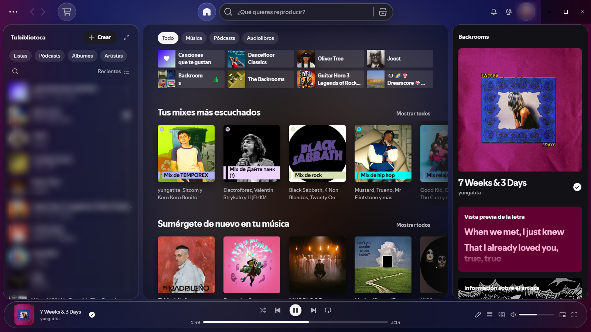
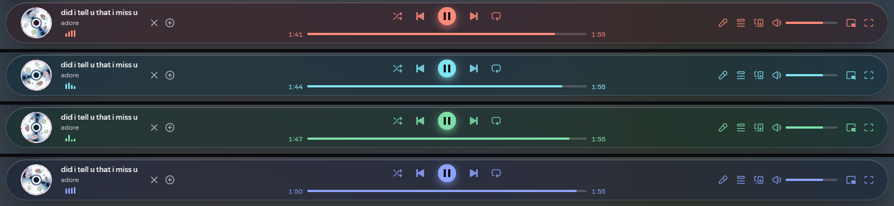
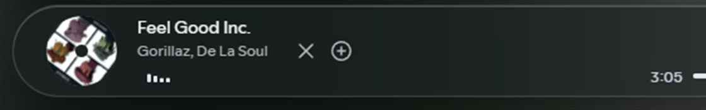
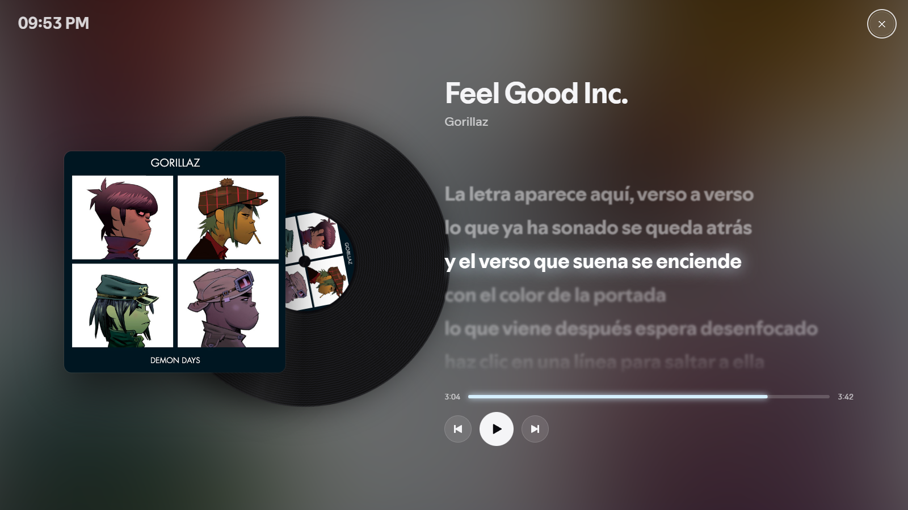
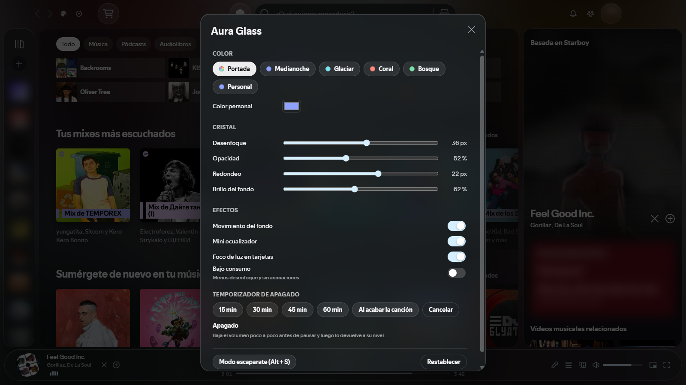

# Aura Glass — Enhanced Edition

[🇬🇧 English](README.md) · [🇪🇸 Español](README.es.md) · [🇹🇷 Türkçe](README.tr.md)

**Spotify, with a glass-like look.** Every song transforms the app with colors drawn from its album artwork.

Aura Glass — Enhanced Edition is a community-maintained continuation of [Aura Glass by issacleral](https://github.com/issacleral/aura-glass-spicetify). This edition preserves the original MIT license and adds independent fixes, improvements, and localization. See [Attribution](ATTRIBUTION.md).

Aura Glass is a [Spicetify](https://spicetify.app) theme inspired by Apple's Liquid Glass design. The artwork of the currently playing track becomes the background; panels turn into frosted-glass surfaces tinted by those colors. The player floats like a capsule alongside a spinning vinyl record. Change the song, and the whole palette changes with it.



## Why you'll love it

- **Changes with your music.** The background, glass tint, buttons, progress bar, and volume adapt to each track's artwork.
- **A player with vinyl soul.** The album artwork becomes a spinning record that stops when playback is paused.
- **Showcase mode.** Press `Alt + S` to turn Spotify into a full-screen music display for your living room or second monitor. It features a spinning record, clock, playback controls, and synchronized lyrics. The current line is highlighted, and clicking any line jumps to that moment in the song.
- **Customize without touching code.** Adjust the glass color (artwork-derived, four presets, or your own), blur, opacity, corner radius, and brightness from the settings panel. Changes apply instantly and are saved.
- **Sleep timer.** Set it for 15, 30, 45, or 60 minutes, or for the end of the current track. The volume fades down before playback pauses, then returns to its previous level.
- **Beautiful and readable.** Glass effects are used on sidebars and panels, not over your lists. If the artwork produces a hard-to-read color, the theme automatically adjusts it for legibility.
- **Easy on your computer.** Animations pause when Spotify is in the background. Low-power mode reduces blur and disables animations.
- **Accessible.** Respects your operating system's reduce-transparency, high-contrast, and reduce-motion preferences. The settings panel and showcase mode are keyboard accessible.

## Screenshots

### A player that changes color with every cover

Buttons, timestamps, progress bar, volume, and the play button adapt to the artwork. Here is the same player in four different palettes:



### Artwork as a spinning vinyl record

A round record with a center label. It spins during playback and stops when paused.



### Showcase mode (`Alt + S`)

A full-screen view with artwork, spinning vinyl, a clock, and synchronized lyrics. Past lines fade, the current line lights up, and upcoming lines stay blurred.



### Settings panel

Glass color, blur, opacity, corner radius, brightness, effects, and sleep timer — no code editing required.



## Installation

### From the Marketplace (recommended)

1. Open Spotify with Spicetify and go to **Marketplace** (the shopping cart icon).
2. Open **Themes**, find **Aura Glass**, and click **Install**.

If Marketplace asks you to set `current_theme` to `marketplace`, run these commands and reopen Spotify:

```bash
spicetify config current_theme marketplace
spicetify apply
```

### Manual installation

1. Copy this folder into your Spicetify themes directory as `AuraGlass`:
   - Windows: `%APPDATA%\\spicetify\\Themes\\AuraGlass`
   - macOS / Linux: `~/.config/spicetify/Themes/AuraGlass`
2. Run:

```bash
spicetify config current_theme AuraGlass color_scheme Gece inject_css 1 replace_colors 1 inject_theme_js 1
spicetify apply
```

## Usage

| To… | Do this… |
| --- | --- |
| Open settings | Click the palette icon in the top-left corner |
| Open showcase mode | Press `Alt + S` or click the vinyl icon in the top-left corner |
| Exit showcase mode | Press `Esc` or click ✕ |
| Jump to a lyric line | Click the lyric line in showcase mode |
| Seek forward or backward | Use the arrow keys on the progress bar (`Shift` for 30 seconds) |
| Set the sleep timer | Settings → Sleep timer |

## Requirements

- Desktop Spotify version supported by Spicetify. The Microsoft Store version does not support Spicetify.
- Spicetify 2.x.

Tested with Spotify 1.3.8 and Spicetify 2.46.4 on Windows 11.

## Credits and license

Based on [Aura Glass by issacleral](https://github.com/issacleral/aura-glass-spicetify). This enhanced edition is independently maintained. The original MIT license and copyright notice are preserved; see [ATTRIBUTION.md](ATTRIBUTION.md) and [LICENSE](LICENSE).


## Contributing a translation

Would you like to add Aura Glass in your language? You can help even without programming experience.

1. Copy README.md and rename the copy to README.<language-code>.md (for example, README.fr.md for French). Use an [ISO 639-1 language code](https://en.wikipedia.org/wiki/List_of_ISO_639-1_codes).
2. Translate reader-facing text: headings, descriptions, feature lists, installation steps, and usage instructions.
3. Keep commands, code blocks, file paths, setting names, keyboard shortcuts, URLs, and product names unchanged. Do not translate identifiers such as AuraGlass, color_scheme, or spicetify.
4. Keep image links and relative paths unchanged unless you add a language-specific image.
5. Add a link for the new language to the selector at the top of every README translation, keeping the same order and format.
6. Open a pull request with the new file and updated language links.

Use clear, natural wording and keep the instructions technically equivalent across languages. If a translation is incomplete, mention that in the pull request so it can be reviewed.

Current documentation languages: English (default), Spanish, and Turkish.
