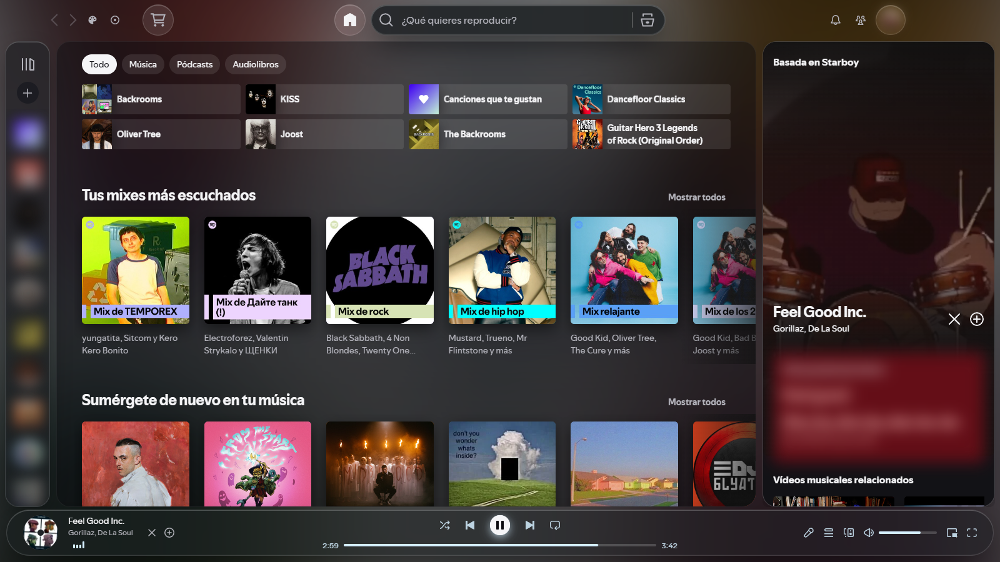
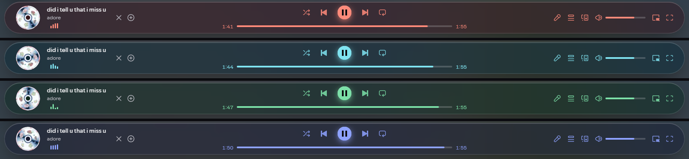
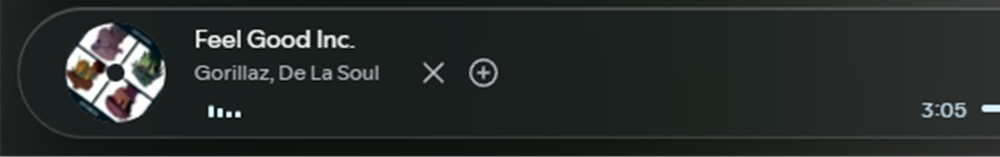
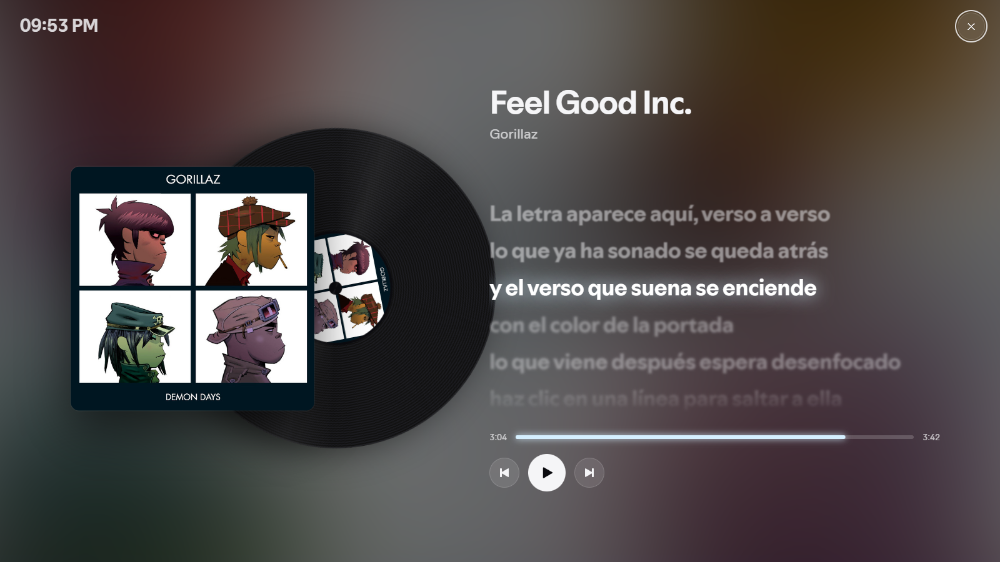
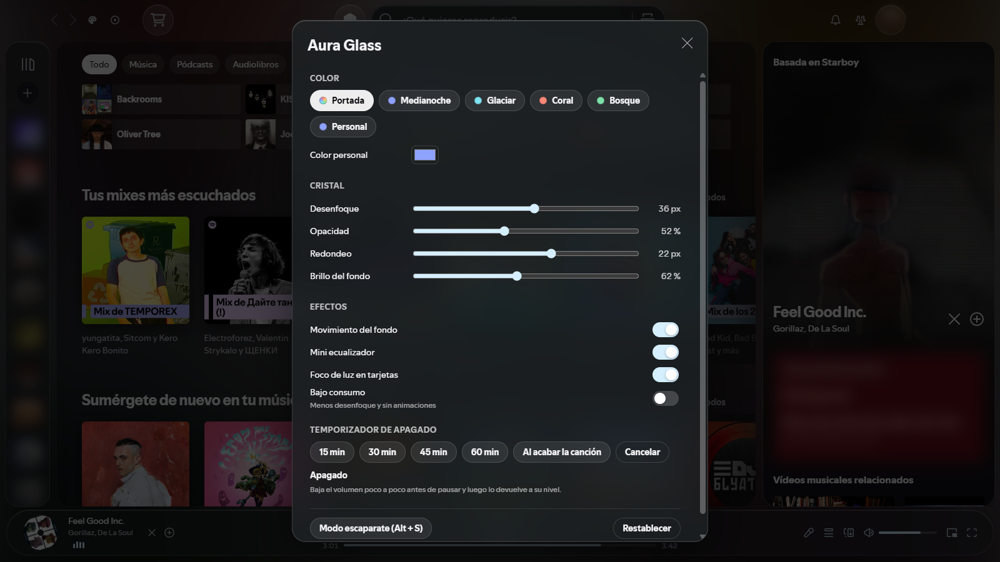

# Aura Glass

**Spotify, pero de cristal.** Cada canción tiñe la app entera con los colores de su portada.

Aura Glass es un tema para [Spicetify](https://spicetify.app) inspirado en el Liquid Glass de Apple. La portada de lo que suena se convierte en el fondo, los paneles son de cristal esmerilado que toma su color y el reproductor flota como una cápsula con un disco que gira. Pones otra canción y todo cambia de color con ella.



## Por qué te va a gustar

- **Cambia con tu música.** El fondo, el tinte del cristal, los botones, la barra de progreso y el volumen se adaptan a la portada de cada canción. Nunca se ve igual dos veces.
- **Un reproductor con alma de vinilo.** La portada es un disco que gira mientras suena y se para cuando pausas.
- **Modo escaparate para dejarlo puesto.** Pulsa `Alt + S` y Spotify se convierte en una pantalla para el salón o el segundo monitor: vinilo girando, reloj, controles y la **letra sincronizada**, que se enfoca verso a verso. Haz clic en cualquier línea y la canción salta a ese momento.
- **Lo ajustas sin tocar código.** Un panel con el color del cristal (el de la portada, 4 paletas o el tuyo), desenfoque, opacidad, redondeo y brillo. Los cambios se ven al momento y se guardan.
- **Temporizador para dormirte con música.** Elige 15, 30, 45 o 60 minutos, o "al acabar la canción". El volumen baja poco a poco antes de pausar, sin cortes bruscos, y luego vuelve a su nivel.
- **Bonito y legible.** El cristal va en las barras y los paneles, nunca encima de tus listas. Si la portada da un color poco legible, el tema lo aclara solo para que siempre se lea bien.
- **No se come tu ordenador.** Las animaciones se paran cuando Spotify está en segundo plano, y el modo "Bajo consumo" reduce el desenfoque y quita las animaciones.
- **Accesible.** Respeta "reducir transparencia", "más contraste" y "reducir movimiento" de tu sistema, y todo el panel y el escaparate se manejan con teclado.

## Así se ve

### El reproductor se tiñe con cada portada

Botones, tiempos, barra de progreso, volumen y el botón de play cambian de color con la portada que suena. Aquí, el mismo reproductor con cuatro colores distintos:



### La portada es un disco que gira

Redonda, con el agujero central de un vinilo. Gira mientras suena y se para al pausar.



### Modo escaparate (`Alt + S`)

Pantalla completa con la portada, el vinilo girando, el reloj y la letra sincronizada: lo que ya sonó se atenúa, el verso actual brilla y lo que viene espera desenfocado.



### Panel de ajustes

Color del cristal, desenfoque, opacidad, redondeo, brillo, efectos y temporizador de apagado. Sin tocar código.



## Instalación

### Desde el Marketplace (recomendado)

1. Abre Spotify con Spicetify y entra en el **Marketplace** (el icono del carrito).
2. Ve a **Temas**, busca **Aura Glass** y pulsa **Instalar**.

Si el Marketplace te pide poner `current_theme` en `marketplace`, ejecuta esto y vuelve a abrir Spotify:

```bash
spicetify config current_theme marketplace
spicetify apply
```

### A mano

1. Copia esta carpeta en la carpeta de temas de Spicetify, con el nombre `AuraGlass`:
   - Windows: `%APPDATA%\spicetify\Themes\AuraGlass`
   - macOS / Linux: `~/.config/spicetify/Themes/AuraGlass`
2. Ejecuta:

```bash
spicetify config current_theme AuraGlass color_scheme Noche inject_css 1 replace_colors 1 inject_theme_js 1
spicetify apply
```

## Cómo se usa

| Para… | Haz… |
| --- | --- |
| Abrir los ajustes | Icono de paleta, arriba a la izquierda |
| Entrar en el modo escaparate | `Alt + S` o el icono de disco, arriba a la izquierda |
| Salir del modo escaparate | `Esc` o la ✕ |
| Saltar a un verso | Clic en la línea de la letra (en el escaparate) |
| Adelantar o retroceder | Flechas sobre la barra de progreso (`Mayús` para 30 s) |
| Programar el apagado | Ajustes → Temporizador de apagado |

## Requisitos

- Spotify de escritorio. La versión de Microsoft Store no admite Spicetify.
- Spicetify 2.x.

Probado con Spotify 1.3.8 y Spicetify 2.46.4 en Windows 11.

## Licencia

MIT
